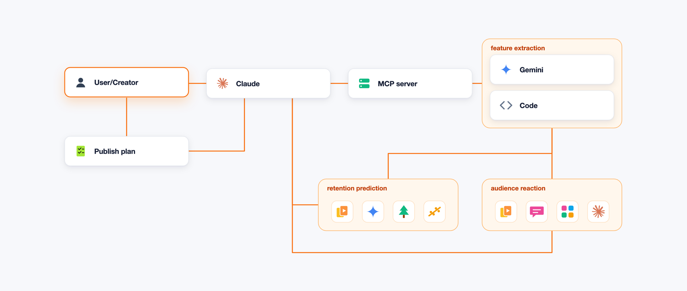

# Architecture Diagram Kit

A small kit for making clean, interactive architecture diagrams. You describe a system in one spec
file; the kit builds a single self-contained HTML page (no server, no dependencies) and can export PNGs.



It is also an agent skill: `SKILL.md` tells Claude, Devin or similar how to use the kit.

## Quick start

Requires Python 3 for building, and Chrome or Chromium for PNG export.

```bash
cp starter/diagram.js ~/my-project/docs/architecture.diagram.js    # 1. copy the starter spec
#                                                                    2. edit it (docs/spec.md)
bin/build.py ~/my-project/docs/architecture.diagram.js              # 3. build -> architecture.diagram.html
bin/export-png.sh ~/my-project/docs/architecture.diagram.html       # 4. optional PNG
```

Open the HTML in a browser. Right arrow / Space steps forward, Left steps back, Esc leaves a detail page.

To see it working first: `bin/build.py examples/shorts-copilot/diagram.js -o /tmp/demo.html && open /tmp/demo.html`

## How it is organised

Each file has one job. A diagram is `spec + theme + styles + icons + engine`, joined by the build script.

| Path | Its one job | Depends on |
|---|---|---|
| `starter/diagram.js` | Blank-ish spec to copy into a project | spec format |
| `themes/default.css` | Design tokens: every colour and the font | nothing |
| `themes/indigo.css` | Example alternative theme (overrides the accent only) | token names |
| `src/diagram.css` | How components look (cards, lines, groups, pills), using tokens only | token names |
| `src/icons.js` | The icon library | nothing |
| `src/engine.js` | Draws a spec and runs the step-through interaction; holds shape sizes (`GEOMETRY`) | spec format, CSS class names |
| `src/gallery.js` | The icon gallery page | icon library |
| `src/shell.html` | Page skeleton the build fills in | nothing |
| `bin/build.py` | Joins the pieces into one HTML file | file layout |
| `bin/export-png.sh` | Screenshots a built HTML with headless Chrome | nothing |
| `docs/spec.md` | Reference for the spec format | |
| `docs/design.md` | The look: principles, layout rules, checklist | |
| `docs/icons.md` | How to draw and add an icon | |
| `examples/` | A full example spec and reference PNGs | |
| `SKILL.md` | Workflow for AI agents | |

## Changing things

| I want to... | Change |
|---|---|
| Use different colours for one diagram | Add `themes/<name>.css` overriding tokens, build with `--theme <name>` (or `--theme path/to.css`) |
| Change the default colours or font everywhere | `themes/default.css` |
| Change how a component looks (border weight, text size, shadow, hover lift) | `src/diagram.css` |
| Change shape sizes or detail-page layout | `GEOMETRY` at the top of `src/engine.js` |
| Add an icon for one diagram | `icons:{...}` in that diagram's spec |
| Add an icon for everyone | `src/icons.js`, then `bin/build.py --icons -o /tmp/icons.html && bin/export-png.sh /tmp/icons.html examples/icons.png ""` |
| Change keyboard behaviour or animation | `src/engine.js` |
| Change the design guidance agents follow | `docs/design.md` |

After changing anything in `src/` or `themes/`, rebuild the example and look at it to check nothing broke:

```bash
bin/build.py examples/shorts-copilot/diagram.js -o /tmp/demo.html
bin/export-png.sh /tmp/demo.html /tmp/demo.png "step=7&u=0.5"
bin/export-png.sh /tmp/demo.html /tmp/demo-detail.png "view=rp&dstep=end"
```

## Using it as an agent skill

Link the folder into the tool's skills directory, for example:

```bash
ln -s "$(pwd)" ~/.claude/skills/architecture-diagram-creator
```

## Note on logos

`src/icons.js` includes the Claude and Gemini marks, which belong to Anthropic and Google. Use them only
to refer to those products.
